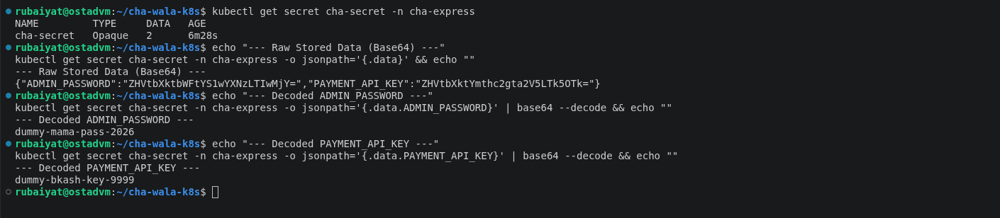

# ☕ Cha-Wala on Kubernetes — Rahim Mama's Cha

**Name:** Md. Rubaiyat Rahim<br/>
**Batch:** DevOps Batch 14<br/>
**Assignment Title:** Chawala on Kubernetes<br/>

Deployment and operations assignment for **Rahim Mama's Cha** (Dhaka) on Kubernetes, covering cluster setup, ConfigMaps, Secrets, Deployments, Services, rolling updates, rollbacks, and debugging.

## Environment
* **OS:** Ubuntu Linux
* **Kubernetes Cluster:** Minikube (`--driver=docker`)
* **Namespace:** `cha-express`

---

## Task 1: Cluster & Namespace

### 1. Cluster Setup & Node Information
A local single-node Kubernetes cluster was provisioned using **Minikube** with the Docker driver:

```bash
minikube start --driver=docker
kubectl get nodes -o wide
```

### 2. Namespace Creation (`cha-express`)
All application resources are isolated inside the `cha-express` namespace, created declaratively using [`manifests/01-namespace.yaml`](./manifests/01-namespace.yaml):

```bash
kubectl apply -f manifests/01-namespace.yaml
kubectl get namespaces
```


### 3. Control Plane Components
Control plane pods running in the `kube-system` namespace were inspected with:

```bash
kubectl get pods -n kube-system -o wide
```

| Component Pod | Role in the Cluster |
|---|---|
| **`kube-apiserver-minikube`** | Frontend for the Kubernetes control plane; exposes the REST API and validates/processes all `kubectl` and internal cluster requests. |
| **`etcd-minikube`** | Consistent, distributed key-value store that holds all cluster state, configuration, and object metadata. |
| **`kube-scheduler-minikube`** | Watches for newly created Pods with no assigned node and selects the best node to run them on based on resources and constraints. |
| **`kube-controller-manager-minikube`** | Runs core controller loops (Node, Deployment, ReplicaSet, Endpoints) that continuously reconcile actual cluster state with desired state. |

*(Additional cluster add-ons also observed in `kube-system`: `coredns` for internal cluster DNS resolution, `kube-proxy` for Service network routing, and `storage-provisioner` for dynamic PersistentVolumes.)*


---

## Task 2: ConfigMap (`cha-config`)

A ConfigMap named `cha-config` was created in the `cha-express` namespace using [`manifests/02-configmap.yaml`](./manifests/02-configmap.yaml). It stores both application configuration key-value pairs and the static `index.html` storefront page for Rahim Mama's Cha.

### Configuration Keys Included

| Key | Value / Purpose |
|---|---|
| `SHOP_NAME` | `Rahim Mama's Cha` |
| `CITY` | `Dhaka` |
| `THEME_COLOR` | `#8B4513` |
| `OPENING_HOURS` | `7:00 AM - 11:00 PM` |
| `index.html` | Responsive HTML/CSS menu displaying 5 tea items (*Malai Cha*, *Masala Dudh Cha*, *Lebu Rong Cha*, *Ada Cha*, and *Tandoori Matka Cha*) with prices in BDT (`৳`). |

### Commands Used

```bash
kubectl apply -f manifests/02-configmap.yaml
kubectl get configmap cha-config -n cha-express
kubectl describe configmap cha-config -n cha-express
```


---

## Task 3: Secret (`cha-secret`)

An `Opaque` Secret named `cha-secret` was created in the `cha-express` namespace using [`manifests/03-secret.yaml`](./manifests/03-secret.yaml) with dummy values for `ADMIN_PASSWORD` and `PAYMENT_API_KEY` (no real credentials are committed to this repository).

```bash
kubectl apply -f manifests/03-secret.yaml
kubectl get secret cha-secret -n cha-express
```

### Question: Are Kubernetes Secrets encrypted?

**No.** By default, Kubernetes Secrets are only **Base64-encoded**, not encrypted.

* Base64 is a reversible encoding format designed to safely represent binary or special-character data in YAML/JSON—it provides **zero cryptographic security**.
* Anyone with RBAC permission to `get` Secrets in the namespace (or direct read access to `etcd`) can decode the values back into plaintext instantly without any decryption key.
* To actually protect Secrets at rest in production, cluster administrators must explicitly configure an `EncryptionConfiguration` on `kube-apiserver` (for `etcd` encryption at rest), enforce strict RBAC, and/or use external secret managers (such as Sealed Secrets, External Secrets Operator, or HashiCorp Vault).

### Proof

Retrieving the stored values from Kubernetes and decoding them with `base64 --decode` reveals the original plaintext immediately:

```bash
# 1. Inspect the raw stored values in Kubernetes (Base64-encoded)
kubectl get secret cha-secret -n cha-express -o jsonpath='{.data}' && echo ""
# Output: {"ADMIN_PASSWORD":"ZHVtbXktbWFtYS1wYXNzLTIwMjY=","PAYMENT_API_KEY":"ZHVtbXktYmthc2gta2V5LTk5OTk="}

# 2. Decode both values back to plaintext without any key
kubectl get secret cha-secret -n cha-express -o jsonpath='{.data.ADMIN_PASSWORD}' | base64 --decode && echo ""
# Output: dummy-mama-pass-2026

kubectl get secret cha-secret -n cha-express -o jsonpath='{.data.PAYMENT_API_KEY}' | base64 --decode && echo ""
# Output: dummy-bkash-key-9999
```

