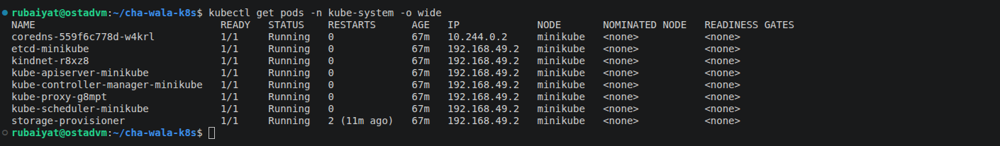

# ☕ Cha-Wala on Kubernetes — Rahim Mama's Cha

**Name:** Md. Rubaiyat Rahim<br/>
**Batch:** DevOps Batch 14<br/>
**Assignment Title:** Chawala on Kubernetes<br/>

Deployment and operations assignment for **Rahim Mama's Cha** (Dhaka) on Kubernetes, covering cluster setup, ConfigMaps, Secrets, Deployments, Services, rolling updates, rollbacks, and debugging.

## Environment
* **OS:** Ubuntu Linux
* **Kubernetes Cluster:** Minikube (`--driver=docker`)
* **Namespace:** `cha-express`

---

## Task 1: Cluster & Namespace

### 1. Cluster Setup & Node Information
A local single-node Kubernetes cluster was provisioned using **Minikube** with the Docker driver:

```bash
minikube start --driver=docker
kubectl get nodes -o wide
```

### 2. Namespace Creation (`cha-express`)
All application resources are isolated inside the `cha-express` namespace, created declaratively using [`manifests/01-namespace.yaml`](./manifests/01-namespace.yaml):

```bash
kubectl apply -f manifests/01-namespace.yaml
kubectl get namespaces
```


### 3. Control Plane Components
Control plane pods running in the `kube-system` namespace were inspected with:

```bash
kubectl get pods -n kube-system -o wide
```

| Component Pod | Role in the Cluster |
|---|---|
| **`kube-apiserver-minikube`** | Frontend for the Kubernetes control plane; exposes the REST API and validates/processes all `kubectl` and internal cluster requests. |
| **`etcd-minikube`** | Consistent, distributed key-value store that holds all cluster state, configuration, and object metadata. |
| **`kube-scheduler-minikube`** | Watches for newly created Pods with no assigned node and selects the best node to run them on based on resources and constraints. |
| **`kube-controller-manager-minikube`** | Runs core controller loops (Node, Deployment, ReplicaSet, Endpoints) that continuously reconcile actual cluster state with desired state. |

*(Additional cluster add-ons also observed in `kube-system`: `coredns` for internal cluster DNS resolution, `kube-proxy` for Service network routing, and `storage-provisioner` for dynamic PersistentVolumes.)*




