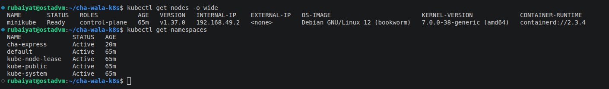
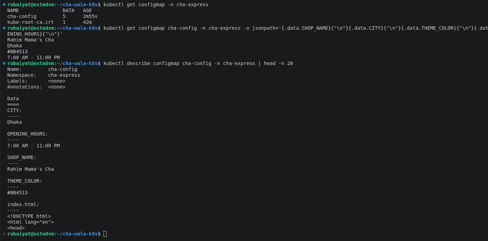
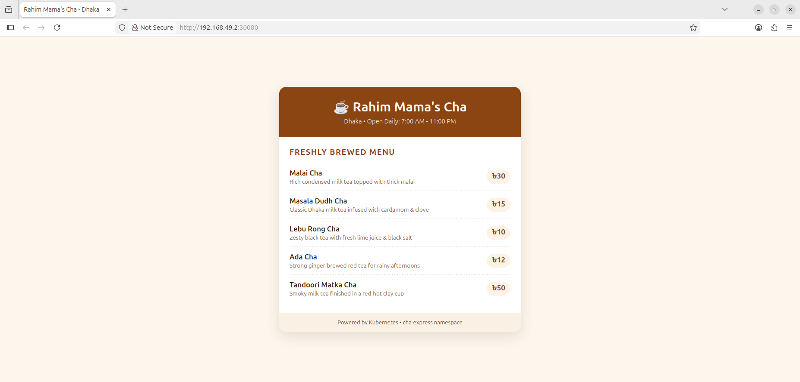
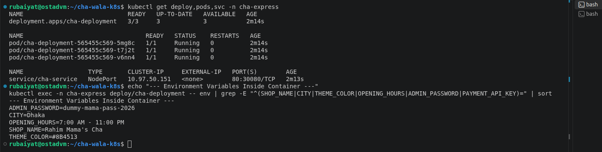
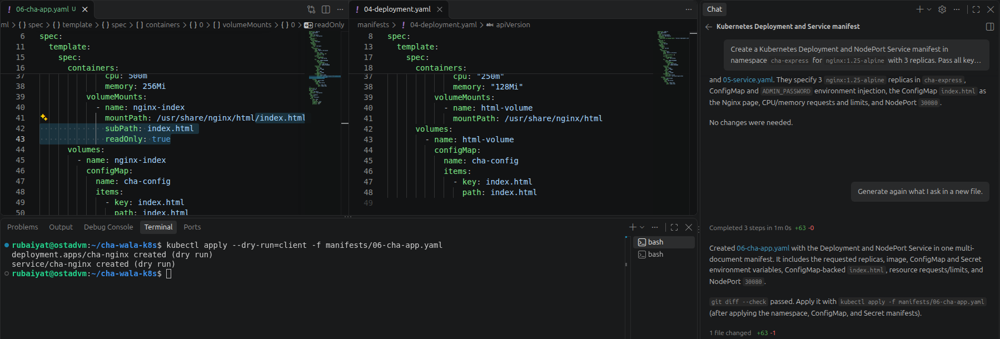
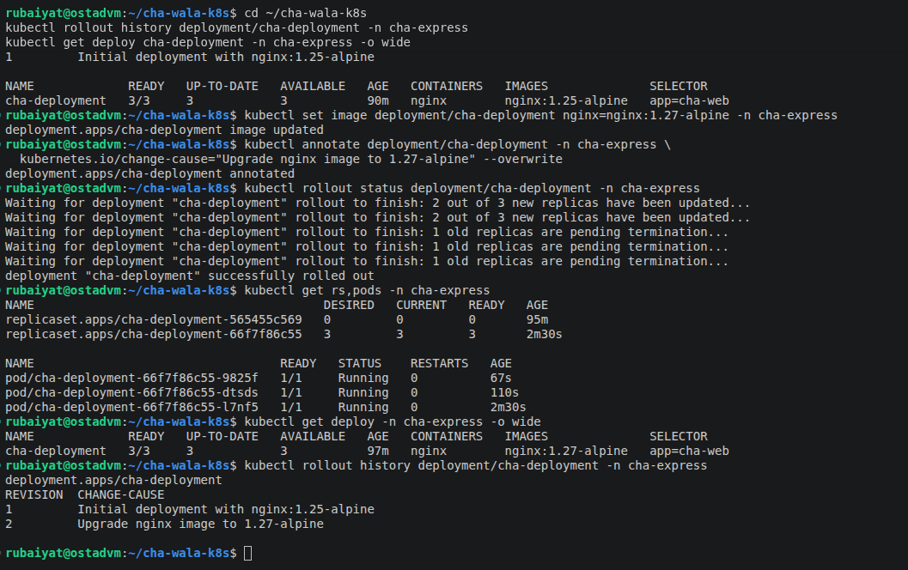
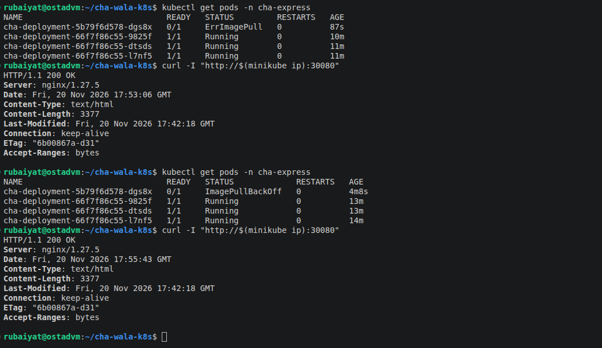
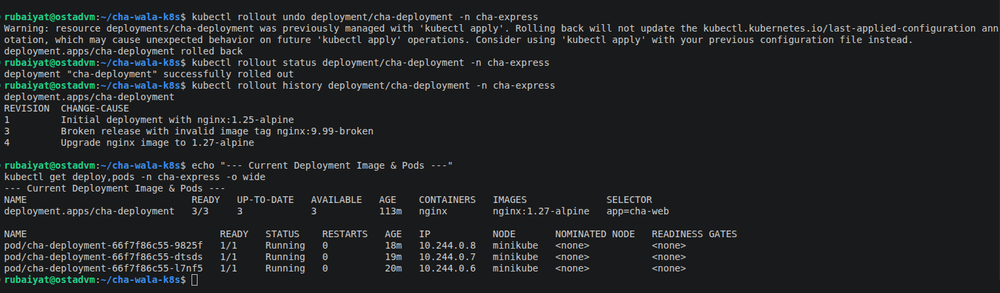
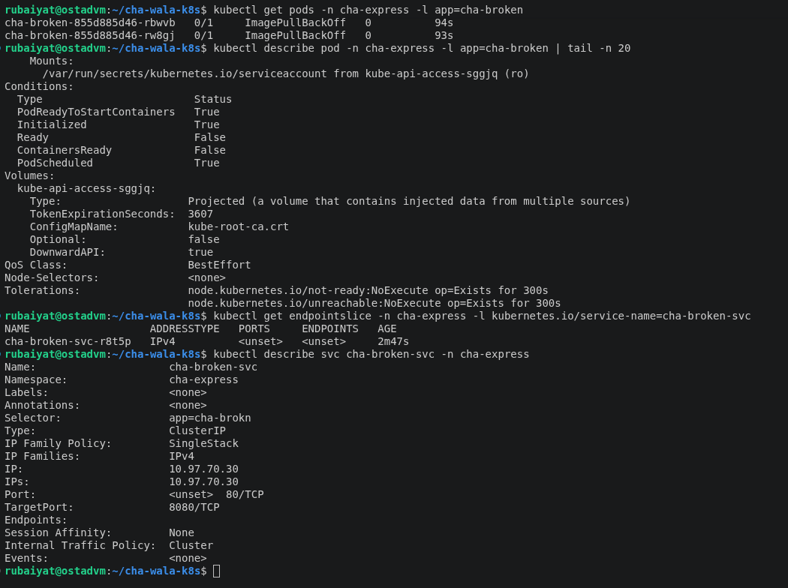
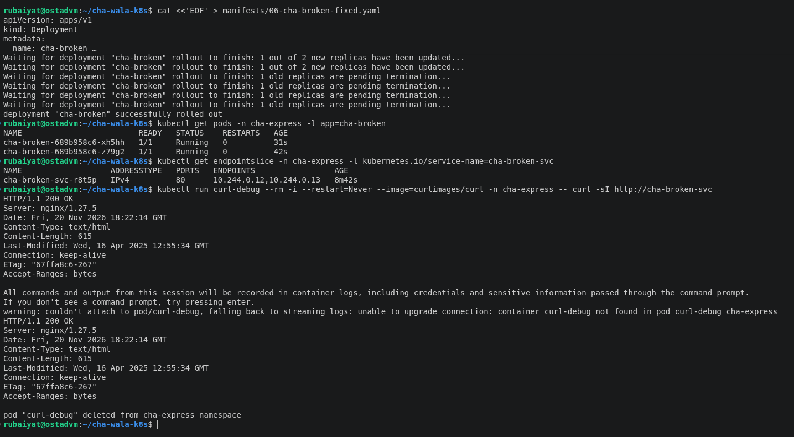

# ☕ Cha-Wala on Kubernetes — Rahim Mama's Cha

**Name:** Md. Rubaiyat Rahim<br/>
**Batch:** DevOps Batch 14<br/>
**Assignment Title:** Chawala on Kubernetes<br/>

Deployment and operations assignment for **Rahim Mama's Cha** (Dhaka) on Kubernetes, covering cluster setup, ConfigMaps, Secrets, Deployments, Services, rolling updates, rollbacks, and debugging.

## Environment
* **OS:** Ubuntu Linux
* **Kubernetes Cluster:** Minikube (`--driver=docker`)
* **Namespace:** `cha-express`

---

## Task 1: Cluster & Namespace

### 1. Cluster Setup & Node Information
A local single-node Kubernetes cluster was provisioned using **Minikube** with the Docker driver:

```bash
minikube start --driver=docker
kubectl get nodes -o wide
```

### 2. Namespace Creation (`cha-express`)
All application resources are isolated inside the `cha-express` namespace, created declaratively using [`manifests/01-namespace.yaml`](./manifests/01-namespace.yaml):

```bash
kubectl apply -f manifests/01-namespace.yaml
kubectl get namespaces
```



### 3. Control Plane Components
Control plane pods running in the `kube-system` namespace were inspected with:

```bash
kubectl get pods -n kube-system -o wide
```

| Component Pod | Role in the Cluster |
|---|---|
| **`kube-apiserver-minikube`** | Frontend for the Kubernetes control plane; exposes the REST API and validates/processes all `kubectl` and internal cluster requests. |
| **`etcd-minikube`** | Consistent, distributed key-value store that holds all cluster state, configuration, and object metadata. |
| **`kube-scheduler-minikube`** | Watches for newly created Pods with no assigned node and selects the best node to run them on based on resources and constraints. |
| **`kube-controller-manager-minikube`** | Runs core controller loops (Node, Deployment, ReplicaSet, Endpoints) that continuously reconcile actual cluster state with desired state. |

*(Additional cluster add-ons also observed in `kube-system`: `coredns` for internal cluster DNS resolution, `kube-proxy` for Service network routing, and `storage-provisioner` for dynamic PersistentVolumes.)*


---

## Task 2: ConfigMap (`cha-config`)

A ConfigMap named `cha-config` was created in the `cha-express` namespace using [`manifests/02-configmap.yaml`](./manifests/02-configmap.yaml). It stores both application configuration key-value pairs and the static `index.html` storefront page for Rahim Mama's Cha.

### Configuration Keys Included

| Key | Value / Purpose |
|---|---|
| `SHOP_NAME` | `Rahim Mama's Cha` |
| `CITY` | `Dhaka` |
| `THEME_COLOR` | `#8B4513` |
| `OPENING_HOURS` | `7:00 AM - 11:00 PM` |
| `index.html` | Responsive HTML/CSS menu displaying 5 tea items (*Malai Cha*, *Masala Dudh Cha*, *Lebu Rong Cha*, *Ada Cha*, and *Tandoori Matka Cha*) with prices in BDT (`৳`). |

### Commands Used

```bash
kubectl apply -f manifests/02-configmap.yaml
kubectl get configmap cha-config -n cha-express
kubectl describe configmap cha-config -n cha-express
```


---

## Task 3: Secret (`cha-secret`)

An `Opaque` Secret named `cha-secret` was created in the `cha-express` namespace using [`manifests/03-secret.yaml`](./manifests/03-secret.yaml) with dummy values for `ADMIN_PASSWORD` and `PAYMENT_API_KEY` (no real credentials are committed to this repository).

```bash
kubectl apply -f manifests/03-secret.yaml
kubectl get secret cha-secret -n cha-express
```

### Question: Are Kubernetes Secrets encrypted?

**No.** By default, Kubernetes Secrets are only **Base64-encoded**, not encrypted.

* Base64 is a reversible encoding format designed to safely represent binary or special-character data in YAML/JSON—it provides **zero cryptographic security**.
* Anyone with RBAC permission to `get` Secrets in the namespace (or direct read access to `etcd`) can decode the values back into plaintext instantly without any decryption key.
* To actually protect Secrets at rest in production, cluster administrators must explicitly configure an `EncryptionConfiguration` on `kube-apiserver` (for `etcd` encryption at rest), enforce strict RBAC, and/or use external secret managers (such as Sealed Secrets, External Secrets Operator, or HashiCorp Vault).

### Proof

Retrieving the stored values from Kubernetes and decoding them with `base64 --decode` reveals the original plaintext immediately:

```bash
# 1. Inspect the raw stored values in Kubernetes (Base64-encoded)
kubectl get secret cha-secret -n cha-express -o jsonpath='{.data}' && echo ""
# Output: {"ADMIN_PASSWORD":"ZHVtbXktbWFtYS1wYXNzLTIwMjY=","PAYMENT_API_KEY":"ZHVtbXktYmthc2gta2V5LTk5OTk="}

# 2. Decode both values back to plaintext without any key
kubectl get secret cha-secret -n cha-express -o jsonpath='{.data.ADMIN_PASSWORD}' | base64 --decode && echo ""
# Output: dummy-mama-pass-2026

kubectl get secret cha-secret -n cha-express -o jsonpath='{.data.PAYMENT_API_KEY}' | base64 --decode && echo ""
# Output: dummy-bkash-key-9999
```


---

## Task 4: Deployment & Service

### 1. Deployment (`cha-deployment`)
Created [`manifests/04-deployment.yaml`](./manifests/04-deployment.yaml) in the `cha-express` namespace with the following configuration:

* **Image & Replicas:** `nginx:1.25-alpine` with `3` replicas.
* **ConfigMap Environment Variables:** Injected all key-value pairs from `cha-config` via `envFrom.configMapRef`.
* **Selective Secret Injection:** Injected **only** `ADMIN_PASSWORD` from `cha-secret` via `env[].valueFrom.secretKeyRef` (keeping `PAYMENT_API_KEY` out of the container environment).
* **Custom HTML Page:** Mounted `index.html` from `cha-config` onto `/usr/share/nginx/html` using `volumes[].configMap.items` (without `subPath`, allowing live volume updates).
* **Resource Management:** Requests (`100m` CPU, `64Mi` memory) and Limits (`250m` CPU, `128Mi` memory).

### 2. NodePort Service (`cha-service`)
Created [`manifests/05-service.yaml`](./manifests/05-service.yaml) exposing port `80` externally on NodePort `30080`.

```bash
kubectl apply -f manifests/04-deployment.yaml
kubectl apply -f manifests/05-service.yaml
kubectl get deploy,pods,svc -n cha-express
```

### 3. Browser Verification
Accessed the live menu at `http://<minikube-ip>:30080`:



### 4. Container Environment Variables Proof
Verified inside a running pod that all `cha-config` keys and `ADMIN_PASSWORD` are present, while `PAYMENT_API_KEY` is excluded:

```bash
kubectl exec -n cha-express deploy/cha-deployment -- env | grep -E "^(SHOP_NAME|CITY|THEME_COLOR|OPENING_HOURS|ADMIN_PASSWORD|PAYMENT_API_KEY)=" | sort
```


---

## Task 5: GitHub Copilot

### 1. Prompt Given to GitHub Copilot
Used GitHub Copilot Chat inside VS Code with the following prompt:

> *"Create a Kubernetes Deployment and NodePort Service manifest in namespace `cha-express` for `nginx:1.25-alpine` with 3 replicas. Pass all keys from ConfigMap `cha-config` as environment variables, pass only `ADMIN_PASSWORD` from Secret `cha-secret` as an environment variable, serve `index.html` from `cha-config` as Nginx's default page, set CPU and memory requests and limits, and expose the app on NodePort `30080`."*



### 2. What I Had to Change in Copilot's Output (and Why)

| Area | What Copilot Generated | Change Made & Why |
|---|---|---|
| **ConfigMap Volume Mount** | Used `subPath: index.html` under `volumeMounts`. | Removed `subPath` and mounted via `configMap.items` onto `/usr/share/nginx/html`. Files mounted with `subPath` do **not** receive automatic ConfigMap updates from `kubelet`, which would break live HTML updates in the Bonus task. |
---

## Task 6: Rolling Update & Rollback

### 1. Rolling Update to `nginx:1.27-alpine`
Updated the `cha-deployment` container image from `nginx:1.25-alpine` to `nginx:1.27-alpine`, annotated the change reason, and monitored the rollout in progress:

```bash
kubectl set image deployment/cha-deployment nginx=nginx:1.27-alpine -n cha-express
kubectl annotate deployment/cha-deployment -n cha-express \
  kubernetes.io/change-cause="Upgrade nginx image to 1.27-alpine" --overwrite
kubectl rollout status deployment/cha-deployment -n cha-express
```



### 2. Deploying an Invalid Image Tag
Tested a failed release by deploying `nginx:9.99-broken`:

```bash
kubectl set image deployment/cha-deployment nginx=nginx:9.99-broken -n cha-express
kubectl annotate deployment/cha-deployment -n cha-express \
  kubernetes.io/change-cause="Broken release with invalid image tag nginx:9.99-broken" --overwrite
kubectl get pods -n cha-express
curl -I "http://$(minikube ip):30080"
```

The new pod entered `ImagePullBackOff`, while the 3 healthy `nginx:1.27-alpine` pods stayed `Running` and continued serving `HTTP/1.1 200 OK`.



### 3. Rollback & Rollout History
Restored the previous working version (`nginx:1.27-alpine`) and inspected the full rollout history with recorded `CHANGE-CAUSE` annotations:

```bash
kubectl rollout undo deployment/cha-deployment -n cha-express
kubectl rollout status deployment/cha-deployment -n cha-express
kubectl rollout history deployment/cha-deployment -n cha-express
```



### Question: Did the website go down during the update? Explain why or why not.

**No, the website did not go down during either the valid update or the broken image deployment.**

* **RollingUpdate Strategy:** By default, Kubernetes Deployments use the `RollingUpdate` strategy with `maxSurge: 25%` and `maxUnavailable: 25%`. With 3 replicas, Kubernetes rounds up `maxSurge` to 1—meaning it creates 1 new pod (4 total temporarily), waits until that new pod becomes `Ready`, and only then terminates 1 old pod. This repeats one pod at a time until all 3 replicas run `nginx:1.27-alpine`.
* **Service Endpoint Routing:** The `cha-service` NodePort Service only sends traffic to pods whose status is `Ready`. Because at least 2–3 healthy pods remained `Ready` throughout every step of the rollout, user requests never hit a terminating or unready container.
* **Built-in Safety on Bad Releases:** When `nginx:9.99-broken` was deployed, the new pod stayed in `ImagePullBackOff` and never reached `Ready`. Because the new replica was unhealthy, the Deployment controller refused to terminate the existing 3 healthy pods, keeping Rahim Mama's menu online until `kubectl rollout undo` cleaned up the failed ReplicaSet.
---

## Task 7: Debug Challenge — "The Shop Is Closed!"

Applied the broken manifest to the `cha-express` namespace, diagnosed all 4 bugs using `kubectl get`, `kubectl describe`, `EndpointSlice` inspection, and in-cluster `curl` tests, and saved the working manifest in [`manifests/06-cha-broken-fixed.yaml`](./manifests/06-cha-broken-fixed.yaml).

### Broken State Observation


### Bug Breakdown

#### Bug 1: Invalid Container Image Tag
* **Symptom Observed:** Both `cha-broken` pods stayed in `0/1` with status `ErrImagePull` / `ImagePullBackOff`.
* **How It Was Identified:** Ran `kubectl get pods -n cha-express -l app=cha-broken` and `kubectl describe pod`, where the Events log reported a failed image pull (`manifest for nginx:1.27-alpinee not found`).
* **Root Cause:** Typo in the container image tag — `nginx:1.27-alpinee` has an extra `e`.
* **How It Was Fixed:** Corrected the image field to `nginx:1.27-alpine`.

#### Bug 2: Misspelled ConfigMap Reference
* **Symptom Observed:** After fixing the image tag, pods failed to start and stayed in `CreateContainerConfigError`.
* **How It Was Identified:** Ran `kubectl describe pod -n cha-express -l app=cha-broken`; the Events section showed `Error: configmap "cha-confg" not found`.
* **Root Cause:** Typo in `envFrom[].configMapRef.name` — `cha-confg` is missing the letter `i` (the actual ConfigMap is named `cha-config`).
* **How It Was Fixed:** Corrected `configMapRef.name` to `cha-config`.

#### Bug 3: Service Selector Label Mismatch
* **Symptom Observed:** Even with pods running, requests to `cha-broken-svc` timed out / could not reach any backend pod.
* **How It Was Identified:** Ran `kubectl get endpointslice -n cha-express -l kubernetes.io/service-name=cha-broken-svc` and `kubectl describe svc cha-broken-svc -n cha-express`, which showed no backing pod IPs (`Endpoints: <none>`).
* **Root Cause:** Typo in the Service selector — `app: cha-brokn` does not match the pod template label `app: cha-broken`.
* **How It Was Fixed:** Updated `spec.selector.app` in `cha-broken-svc` to `cha-broken`.

#### Bug 4: Incorrect Service `targetPort`
* **Symptom Observed:** Requests to `http://cha-broken-svc:80` failed with `Connection refused`.
* **How It Was Identified:** Inspected `kubectl describe svc cha-broken-svc -n cha-express` and `EndpointSlice`, which showed traffic forwarding to `<pod-ip>:8080`, whereas the default `nginx:1.27-alpine` container listens on port `80`.
* **Root Cause:** `ports[].targetPort` was set to `8080` instead of `80`.
* **How It Was Fixed:** Changed `targetPort` to `80`.

### Final Verification After Fixes

```bash
kubectl apply -f manifests/06-cha-broken-fixed.yaml
kubectl get pods -n cha-express -l app=cha-broken
kubectl get endpointslice -n cha-express -l kubernetes.io/service-name=cha-broken-svc
kubectl run curl-debug --rm -i --restart=Never --image=curlimages/curl -n cha-express -- curl -sI http://cha-broken-svc
# Output: HTTP/1.1 200 OK
```

